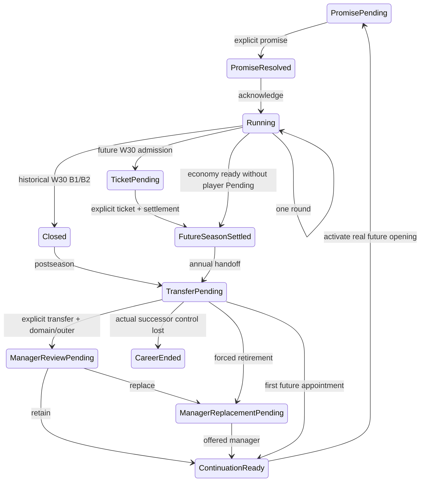

# M102 application bridge — local implementation

This continues local commit `258f17992d61d48137c0125f65195585b2a861e0` on
`feat/owned-season-application-bridge`, based on live main
`64d62c48948e489dc41497170c8ddf39ccd906e1`. It is **IMPLEMENTED LOCALLY**,
**NOT MERGED**. CI is **DEFERRED — ACTIONS QUOTA**. No closure or CI success is
claimed. Final command evidence and exact local HEAD are recorded separately in
the development workspace completion report.

## Public lifecycle

Import `package:futbol_baskanlik_m0/player_president_owned_season_application.dart`.
`PlayerPresidentOwnedSeasonApplication.start()` owns one original application
for the entire career. Consumers switch on `currentStep` and send that exact
object to the corresponding command. All step constructors are private.

| Observation | Consumer command | Existing production owner |
| --- | --- | --- |
| `PromisePending` | `submitPromise` | M73/M56 historical boundary or `acceptFuturePromise` |
| `PromiseResolved` | `continueAfterPromise` | Owned W0; no further match execution |
| `Running` | `advanceRound` | Historical weekly owner or AR-D `advanceFutureWeek` |
| Historical W30 `Running` | `closeSeason` | Genuine B1 then basic/X1 B2 |
| `Closed` | `continueToNextSeason` | B3-B1 application postseason |
| Future W30 `Running` | `completeFutureSeason` | `commitFutureSeason`, `handoffFutureEconomy`, settlement preparation |
| `TicketPending` | `submitTicket` | Exact real economy Pending, then once-only full-M65 settlement |
| `FutureSeasonSettled` | `continueToNextSeason` | `startFuturePostseasonTransition` |
| `TransferPending` | `submitTransfer` | Real production transfer choice and suffix |
| `ManagerReviewPending` | `submitManagerReview` | Real manager review; retain or request replacement |
| `ManagerReplacementPending` | `submitManagerReplacement` | Exact offered manager identity |
| `ContinuationReady` | `activateNextSeason` | Lossless publication, same-application activation, admission, preparation, active future opening |
| `CareerEnded` | None | Actual successor tenure control is lost |
| `Failed` | None | Consumed single-pass stage failed; no replay/retry API |

Names in the table omit the common `PlayerPresidentOwnedSeason` prefix;
`PlayerPresidentOwnedFutureSeasonSettled` and
`PlayerPresidentOwnedCareerEnded` use their full names as declared in source.

Non-player stages run inside the bridge and reuse the existing production
algorithms. Controlled choices are never filled with AI fallback. The first
future appointment keeps manager history empty: no manager season is fabricated
for historical season zero. Later manager-history indices are immutable copies
of the original manager authority's completed seasons.

## Observations and failure boundaries

- Historical `Closed` remains distinct from future finance settlement. Historical
  B2 full-M65 equivalence is still unproven; current basic/X1 B2 is authoritative.
- M65 authority starts at the genuine next/future-season boundary. A future
  settlement observation contains the actual controlled-club finance row and
  immutable W30 snapshot, never the receipt or settlement capability.
- Future promise annual resolution is performed by the production postseason
  domain stage, after transfer. It is not recalculated or predicted by the
  bridge, and is not mislabeled as already available at finance settlement.
- Raw future reports contain mutable legacy standing rows. Consumers receive
  immutable weekly tables/fixtures instead. Historical B1 report getters retain
  their existing defensive-copy behavior.
- `preparedSeasonDashboard`, `preparedSquad` and `preparedSeasonFixtures` remain
  explicitly **initial historical opening observations**. They are not current
  future snapshots; `Running.fixtures` and the actual future promise context
  identify the current season.
- Foreign, stale, duplicate and conflicting repeated events are rejected before
  they reach another authority mutation. Recoverable invalid choices preserve
  the current Pending. Once an underlying single-pass stage fails, the bridge
  publishes `Failed`; it does not claim rollback or invent retry semantics.
- Actual successor tenure loss yields `CareerEnded` before future admission.
  Forced retirement exposes the existing replacement Pending directly.
- Tokens, original application, runtime controllers, prepared recipients,
  continuation graph, settlement capability and transition authority are private.
  No process-global registry, historical replay, restore/clone impersonation,
  fabricated checkpoint, receipt or manager history is introduced.

## Owner scope and acceptance

The saved Flutter/mobile flow is preserved. There is no new mobile entry, button,
screen, transient-career mode, controller switch, persistence contract or schema
change. M65 remains sole persisted game-state authority. M74/M75/M77–M88/M80,
saveVersion, codecs, checksums, migrations, namespaces and workflows are unchanged.

Public-only acceptance tests execute historical closing, future seasons 1 and 2
through real settlement and annual postseason, then genuine future season 3
re-entry. Tests also cover every decision family, stale/foreign/repeated events,
W31, premature closing, immutable observations, exact manager identity, real
historical/future presidency loss, and genuine forced manager retirement.
Existing B3-B low-level proofs remain regression evidence; they are not
substitutes for the new public-only multi-season proof.

Android build is **NOT VERIFIED — KNOWN ENVIRONMENT DISK LIMIT**; the previous
standard debug build exhausted the 8 GB workspace at `mergeDebugNativeLibs`.
Android setup/build is not repeated for this application-only continuation.
